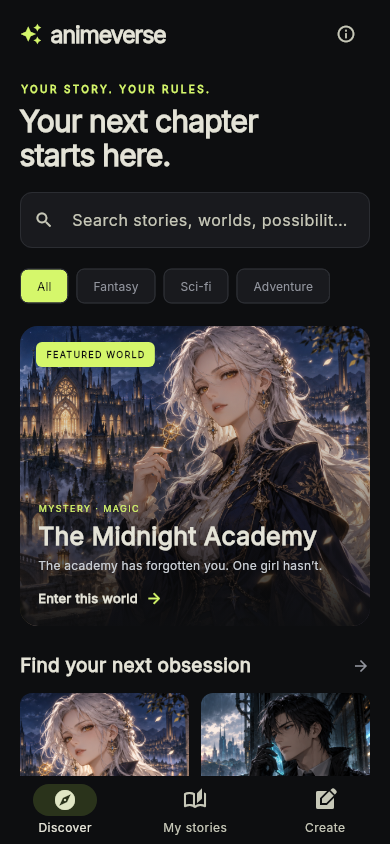
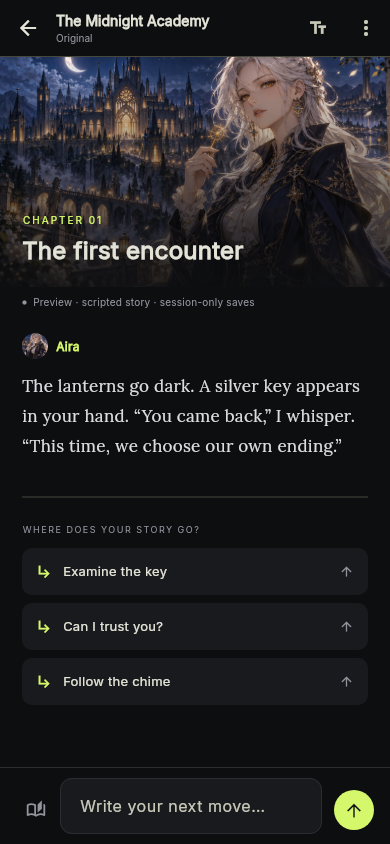
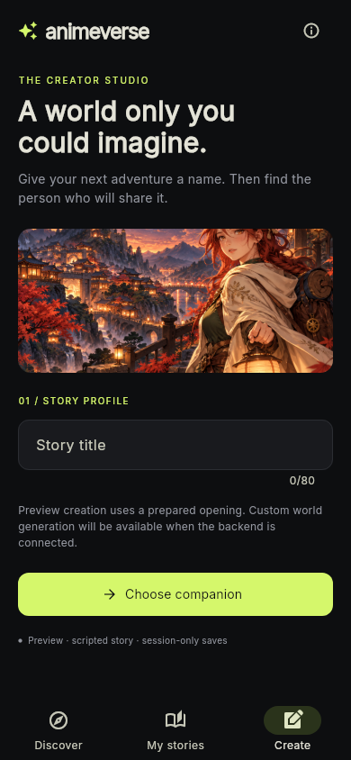

# Animeverse mobile UI redesign

## Reference and design decisions

Reviewed OOC public Play Store screenshots on 2026-10-13: https://play.google.com/store/apps/details?id=com.newai.ooc&hl=en

The illustrated reader screenshot shows a compact title/settings header, scene artwork, prose, suggested actions and a bottom composer. The creator screenshot shows a structured dark editor. These informed hierarchy and workflow, not copied assets or branding. Discovery layout is our original interpretation, not a verified reproduction of OOC's home screen.

Animeverse uses charcoal surfaces, a restrained lime accent, an illustrated featured world, portrait story cards, a scene-led reader and a compact composer. Serif narrative text is visually separated from sans-serif navigation. Demo status remains visible. No popularity, account, credit or AI-status claims are fabricated.

## Real Flutter renders

These screenshots were generated by Flutter tests at 390×844, with actual bundled fonts and decoded assets. They are application renders, not AI-generated UI mockups.

| Discover | Chapter | Create |
|---|---|---|
|  |  |  |

## Assets and licenses

- academy.png, signals.png and lantern.png: original AI-generated anime illustrations, generated with the built-in image-generation tool for this project. No OOC art was used as an input or embedded in the app.
- Art direction: respectively, a silver-haired mage with a luminous key at a midnight academy; a dark-haired investigator with a cyan device in a futuristic city; and an auburn-haired traveler holding a lantern in an ancient mountain town. Landscape artwork, original adults, no text/logos/UI, premium illustrated anime style.
- Inter and Lora: downloaded from Google Fonts' official repository, distributed with SIL Open Font License files. Static default-weight Latin/punctuation subsets were generated and internally renamed Animeverse Sans / Animeverse Serif. Inter and Lora remain application font aliases. Other scripts fall back to the platform font; broad multilingual bundled-font coverage is not yet provided.
- Material icons: Flutter's standard Material icon font.

## Validation

On source commit 3915008de0006e2b4fc46cd0619bfa47aea80e27, Flutter analysis and all seven tests passed. Three tests produce screenshot artifacts; they regenerate previews rather than compare to a fixed golden baseline. Interaction tests cover companion selection, custom actions, empty-title validation and small-screen layout. Session tests cover transcript branch isolation and scoped note editing.

Backend, persistent saves, AI responses and world generation are not connected. Notes remain session-wide rather than branch-specific. Cover scenes are prepared illustrations. APK build status is tracked in the linked pull request and workflow.
